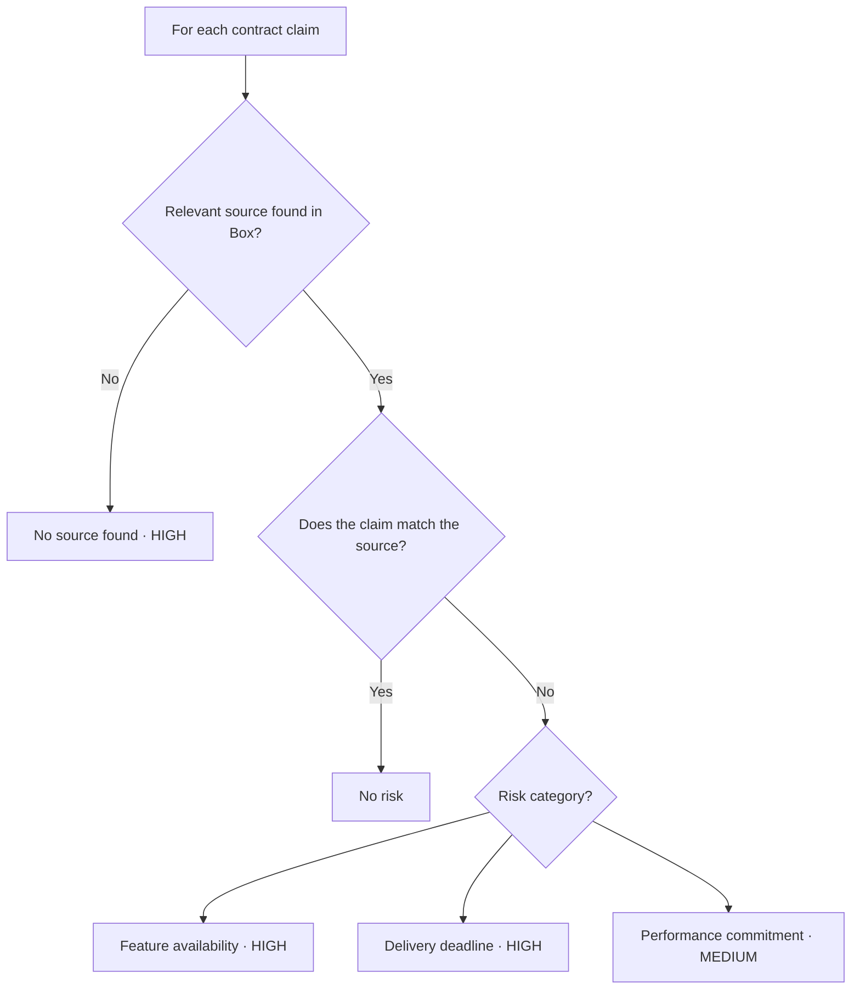
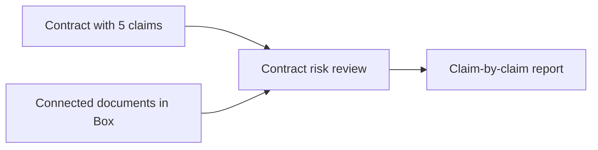

# PRD: Sales Contract Risk Review

## Sample scenario: an enterprise deal for Amazon S3

An AWS field team is helping an enterprise customer move its document archive to Amazon S3. The proposed customer agreement includes commitments about required storage features, migration completion, and retrieval performance.

Before sharing the agreement, the account team needs to know: **Which claims can we substantiate, and which need revision or confirmation from product and operations?**

## Problem

Sales and field teams make customer commitments about features, delivery dates, and performance without easy access to reliable delivery information. They repeatedly follow up with product and operations teams, or make claims based on incomplete or outdated information.

In the S3 deal, the account team might promise a feature by the customer’s launch date without knowing whether its required configuration is supported or whether the migration team can meet that deadline. This creates a gap between what the contract promises and what the business can support.

## Product objective

Review a proposed sales contract before it is shared or signed. Identify customer-facing claims that conflict with—or lack support from—the company's product plans, delivery history, and approved capabilities. Give the field team a clear explanation and supporting evidence for each risk.

**Primary user:** A salesperson or field team member preparing a customer contract.

**Supporting users:** Product and operations owners who clarify or approve commitments that need review. In the guiding example, these are the relevant storage product and migration delivery owners.

## User input

**One current sales contract to review.**

The user uploads the contract, including any referenced schedules or attachments that contain customer commitments. The review covers claims about feature availability, delivery deadlines, and performance.

For the S3 deal, this means the proposed agreement and migration statement of work, including the promised capabilities, completion date, and performance targets.

The user should not need to collect roadmap documents or chase delivery updates before submitting the contract. The system retrieves the relevant internal evidence.

## Information the system needs

Prioritize these three sources in Box:

| Priority | Documents | What they establish |
|---|---|---|
| 1 | **Approved product documentation** | What can be promised today: supported features, configurations, performance benchmarks, and limits. |
| 2 | **Product roadmap and release plans** | What is planned, by when, with which dependencies—and whether the date is a target or an approved commitment. |
| 3 | **Project closeout reports and delivery reviews** | What similar customer projects actually took to deliver, what slipped, and why. |

For the S3 deal, these answer: **Is the capability supported? Is the delivery date credible? Is the performance claim backed?** Each document needs an owner and last-updated date; missing or outdated evidence triggers verification.

## Three priority risks

| Risk | What the system flags | Example in the S3 agreement |
|---|---|---|
| **1. Feature availability** | A promised capability is unavailable or unsupported in the proposed configuration. Check against approved product documentation and the roadmap. | “The required storage feature is included in the selected Region.” Flag if documentation does not support that configuration or the feature is still planned. |
| **2. Delivery deadline** | A promised feature release or migration date lacks a confirmed plan or is inconsistent with comparable delivery outcomes. Check against release plans and delivery reviews. | “The full archive migration will be completed within 30 days.” Flag if similar migrations took 60 days or the required feature has no committed release date. |
| **3. Performance commitment** | A speed, throughput, or scale promise exceeds documented evidence or omits the conditions required to achieve it. Check against approved product documentation and benchmarks. | “Every archived object will be retrievable within one second.” Flag if no evidence supports that promise for the proposed storage class and workload. |

Return only substantiated concerns or explicit verification gaps; a contract does not need a finding in every category. Example commitments and figures are hypothetical.

## Review workflow

1. **Extract claims.** Identify each feature, delivery, and performance commitment, including its conditions and contract location. Split statements containing multiple commitments into separate claims.
2. **Find sources in Box.** Retrieve relevant product documentation, release plans, and delivery reviews for each claim.
3. **Compare claim and evidence.** Check the capability, date, or metric against the source, including Region, configuration, workload, and other applicable conditions.
4. **Assign a result and severity.** Use the rules below. Return a result for every in-scope claim, including those with no risk.

## Decision workflow

A match must cover the claim's conditions, including Region, configuration, date, and workload. A roadmap target does not support a guaranteed release date; a benchmark only supports claims within its tested conditions. Explain outdated or conflicting evidence in the result rather than marking the claim No risk.

## Fixed severity by category

| Result / risk category | Severity |
|---|---|
| Claim matches the source — **No risk** | None |
| **Feature availability** risk | High |
| **Delivery deadline** risk | High |
| **Performance commitment** risk | Medium |
| **No source found** | High |

Severity is fixed by category. No source found means the claim could not be verified against the accessible Box documents; it does not establish that the claim is false.

## Output for each contract

**A claim-by-claim review report**, summarized by counts of No risk, Risk identified, and No source found, with flagged claims ordered by severity.

| Field | What the user sees |
|---|---|
| Claim | Exact wording and contract location. |
| Result | No risk, Risk identified, or No source found. |
| Risk category | Feature availability, Delivery deadline, or Performance commitment for identified risks; not required for No risk or No source found. |
| Severity | High, Medium, or None, using the fixed mapping above. |
| Evidence and explanation | Box source link, relevant passage or data point, last update, and why the claim matches or differs. For missing sources, state what evidence was sought. |

## V1 scope

V1 reviews one contract at a time against the three risk categories and returns a result for every in-scope claim against the three prioritized Box sources. It supports an initial review and a fresh review of a revised contract.

Service-level, support, security, and compliance reviews are outside V1.

Contract drafting, automatic contract changes, approval routing, negotiation, signature, portfolio reporting, and post-signature obligation tracking are outside V1. The report supports human judgment; it does not grant approval to sign.

## Success metrics

**North star — Contract review time saved:** Percentage reduction in median time to complete a contract review versus the manual process, including product and operations follow-ups.

| Supporting metric | Definition |
|---|---|
| **Risk precision** | Percentage of flagged claims that expert reviewers confirm should be flagged. |
| **Risk recall** | Percentage of expert-identified risky claims that the system flags. |
| **Source accuracy** | Percentage of claim results whose cited evidence—or No source found result—is confirmed correct by expert reviewers. |

Measure quality on an expert-reviewed set of contracts across all three risk categories. Establish the manual baseline and pilot targets before launch.

## Full sample: contract in → review report out

*Illustrative only. The customer, feature names, source documents, and figures below are fictional, not actual AWS commitments.*

### Input: customer contract

**Document:** Northstar Archive Migration Agreement

**Scope:** Move Northstar’s document archive to Amazon S3 in the agreed Region and configuration.

1. **Encryption:** “The archive will support encryption at rest in the agreed configuration.”
2. **Feature:** “The archive will include the proposed Smart Archive Search feature at launch.”
3. **Delivery:** “The archive migration will be completed within 30 days of signature.”
4. **Performance:** “The archive will sustain read throughput of 10 GB/s in the agreed configuration.”
5. **Integration:** “The archive will support direct import from Northstar’s LegacyVault system.”

### Review

The user submits the contract. The system uses the connected Box documents and returns the report below.

### Output: contract review report

**Northstar Archive Migration Agreement — 5 claims reviewed**

**1 No risk · 3 Risks identified · 1 No source found**

**Severity: 3 High · 1 Medium · 1 None**

| Contract claim and location | Result | Risk category | Severity | Evidence and explanation |
|---|---|---|---|---|
| §2: “The archive will include the proposed Smart Archive Search feature at launch.” | Risk identified | Feature availability | **High** | **[B2, Feature status]** lists Smart Archive Search as exploratory and unavailable for customer launch. The contract promises an unavailable capability. |
| §3: “The archive migration will be completed within 30 days of signature.” | Risk identified | Delivery deadline | **High** | **[B3, Delivery outcomes]** shows comparable migrations took 58–72 days. The promise is materially shorter than the documented delivery history. |
| §5: “The archive will support direct import from Northstar’s LegacyVault system.” | No source found | — | **High** | No source found for LegacyVault direct-import support in the connected Box documents. The claim cannot be verified. |
| §4: “The archive will sustain read throughput of 10 GB/s in the agreed configuration.” | Risk identified | Performance commitment | **Medium** | **[B1, Performance benchmark]** validates 5 GB/s for the agreed configuration. The contract promises 10 GB/s without supporting evidence. |
| §1: “The archive will support encryption at rest in the agreed configuration.” | No risk | — | None | **[B1, Supported capabilities]** confirms encryption at rest for the agreed configuration. The claim matches the source. |

**Source references returned with the report:**

| Reference | Box document | Last updated |
|---|---|---|
| B1 | Approved Archive Solution Guide — Supported capabilities; Performance benchmark | October 1, 2026 |
| B2 | Archive Product Roadmap — Feature status | October 8, 2026 |
| B3 | Archive Migration Delivery Review — Delivery outcomes | September 30, 2026 |

B1–B3 are illustrative references. In the product, each reference links to the actual Box document and identifies the supporting passage.
