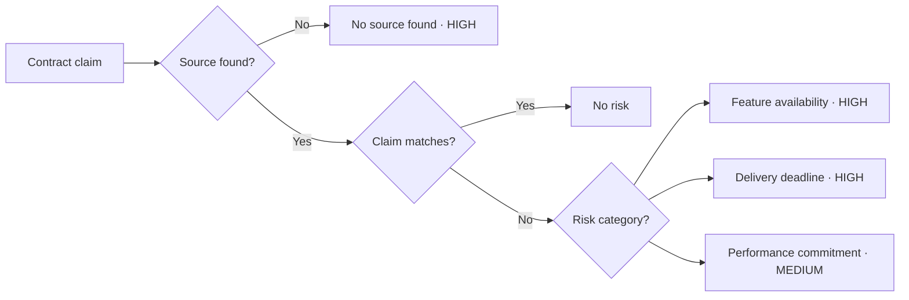

# Instructions: Create a Contract Risk Review Presentation

Create a six-slide presentation for executives and hackathon judges. Make the central purpose explicit: **help sales teams identify risks before making commitments to customers.** Use an enterprise Amazon S3 archive migration as the running example.

Allocate **60 seconds of total speaking time across slides 1, 2, 3, 5, and 6**, plus **2 minutes for the live demo on slide 4**.

## Deliverable and style

For each slide, provide a title, concise on-slide content, a visual layout, and speaker notes that fit the assigned time. For the demo slide, provide a timed walkthrough instead of a conventional talk track.

- Keep the slides crisp, concrete, and easy to scan.
- Use diagrams for the workflows. Keep implementation details out of the presentation.
- Preserve the fixed risk severities below; do not introduce dynamic scoring or Low severity.
- Treat the AWS customer commitments, source documents, and delivery figures as hypothetical examples.
- Do not invent measured benefits, customer adoption, or live capabilities. Present benefits as intended value and enhancements as future work.

## Slide 1 — Identify risks before making customer commitments

**Speaking time: 15 seconds**

Establish the fragmented manual process clearly:

**Draft customer commitment → Search scattered docs → Ask product → Follow up with ops → Piece together answers → Assess risk manually**

Explain that sales teams need to know the risks in a proposed feature, date, or performance claim before promising it to a customer. Today, they piece together scattered documents and ad hoc answers from product and operations, so risks can go unnoticed. Frame the product as helping sales spot those risks before committing.

## Slide 2 — One contract in. An evidence-backed review out.

**Speaking time: 10 seconds**

Show the product as a black box:

**Draft sales contract + Documents in Box → Contract risk review → Risks identified before customer commitment**

Label the three Box sources: **Approved product docs · Roadmap and release plans · Delivery reviews**.

Use the S3 migration deal to explain that the salesperson submits a draft contract and sees which claims carry risks before making those commitments to the customer. Do not explain the internal technology.

## Slide 3 — A simple decision for every claim

**Speaking time: 10 seconds**

Render this decision workflow as a readable diagram:

Explain that each claim receives a result. Matching claims have no risk; mismatches receive a category with fixed severity; missing sources are High. Do not imply that a missing source proves the claim is false.

## Slide 4 — Live demo: five claims, one review

**Demo time: 2 minutes**

Create a minimal demo launch slide with the question: **“What risks should sales see before committing?”** Leave the detailed walkthrough in presenter notes so the presenter can switch to the live product.

Use a five-claim S3 archive migration agreement:

1. Encryption at rest in the agreed configuration.
2. Smart Archive Search available at launch.
3. Migration completed within 30 days.
4. Sustained read throughput of 10 GB/s.
5. Direct import from the customer's LegacyVault system.

The expected report is:

| Claim | Evidence | Result | Severity |
|---|---|---|---|
| Encryption | Approved documentation confirms support. | No risk | None |
| Smart Archive Search | Roadmap lists the feature as exploratory and unavailable at launch. | Feature availability risk | High |
| 30-day migration | Comparable migrations took 58–72 days. | Delivery deadline risk | High |
| 10 GB/s throughput | Benchmark validates 5 GB/s for the agreed configuration. | Performance commitment risk | Medium |
| LegacyVault import | No relevant source found. | No source found | High |

Use this timed walkthrough:

| Time | Presenter action |
|---|---|
| **0:00–0:20** | Open the draft contract and introduce its five proposed claims before any customer commitment is made. |
| **0:20–0:35** | Submit it for review and briefly show the connected Box sources. |
| **0:35–1:00** | Show the summary: **1 No risk · 3 Risks identified · 1 No source found.** |
| **1:00–1:30** | Open the High delivery risk and its source: 30 days promised versus 58–72 days in comparable projects. |
| **1:30–1:50** | Contrast the supported encryption claim with the integration claim marked No source found. |
| **1:50–2:00** | Show the performance mismatch marked Medium and finish on the complete report. |

Use the full sample in PRD.md if available. Otherwise, the hypothetical example above is sufficient. Do not invent Box links or claim that a live demo has already succeeded.

## Slide 5 — Three benefits

**Speaking time: 15 seconds**

Show exactly three benefits:

- **Identify risks before committing:** Surface unsupported features, delivery dates, and performance promises.
- **Make informed commitments:** Give sales source-backed evidence about each proposed claim.
- **Reduce manual checking:** Spend less time searching documents and chasing product/ops.

Keep the speaker notes focused on these outcomes. Do not add unmeasured savings or percentages.

## Slide 6 — Three future enhancements

**Speaking time: 10 seconds**

Show exactly three future enhancements:

1. **Suggested wording:** Propose contract language supported by the evidence.
2. **Owner approvals:** Route exceptions to product or operations.
3. **Continuous rechecks:** Flag affected contracts when roadmaps or capabilities change.

Clearly label these as future enhancements, separate from the current contract-review scope.
